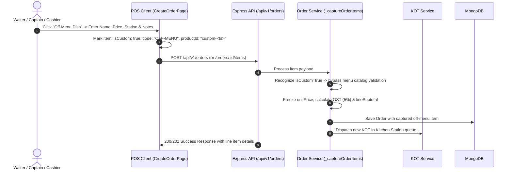
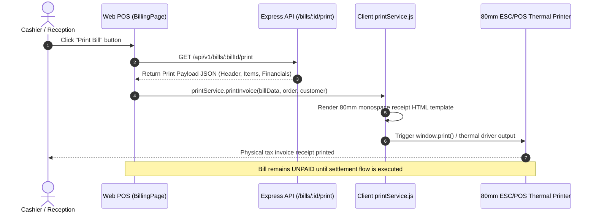

# API Specification & Flow Guide: Off-Menu Items, Swipe Table & Bill Printing

This document provides the end-to-end API technical specifications, sequence diagrams, request/response payloads, and architectural flows for three key restaurant POS operations:
1. **Add Off-Menu Item**
2. **Swipe Table (Table Transfer / Shift / Swap)**
3. **Print the Bill (Tax Invoice / Receipt Printing)**

---

## 1. Add Off-Menu Item

### 1.1 Overview & Business Rules
- **Definition:** Off-menu items are custom dishes, special preparation requests, or non-catalog items requested by guests (e.g. *"Chef Special Halwa"*, *"Extra Garlic Butter Dip"*).
- **Permissions:** Permitted roles include `Admin`, `Manager`, `Reception`, `Cashier`, and `Captain` (`order.create` or `order.modify`).
- **Data Integrity Rules:**
  - Standard product catalog checks are bypassed when `isCustom: true` or `code: "OFF-MENU"` is flagged.
  - Manual pricing (`unitPrice`) entered by staff is captured into the immutable order snapshot.
  - Default GST tax configuration (5% standard or branch tax configuration) is computed dynamically.
  - Custom dishes are assigned to a kitchen preparation station (`Main Curry`, `Tandoor`, `Chinese`, etc.) and routed to the kitchen via Kitchen Order Tickets (KOT).

### 1.2 Endpoints

#### A. Initial Order Creation with Off-Menu Item
- **Method & Path:** `POST /api/v1/orders`
- **Headers:**
  - `Authorization: Bearer <JWT_ACCESS_TOKEN>`
  - `Content-Type: application/json`
  - `Idempotency-Key: <UUID>` *(optional for retry protection)*

##### Request Body
```json
{
  "orderType": "DINE_IN",
  "tableId": "tbl-01",
  "customerName": "Ramesh Gupta",
  "customerPhone": "9876543210",
  "items": [
    {
      "productId": "prod-001",
      "name": "Paneer Butter Masala",
      "quantity": 1,
      "notes": "Medium spicy"
    },
    {
      "isCustom": true,
      "productId": "custom-1730501234567",
      "name": "Chef Special Halwa (Special)",
      "price": 250,
      "quantity": 2,
      "notes": "Less sugar, serve warm",
      "station": "Main Curry",
      "kotRequired": true
    }
  ]
}
```

##### Response (`201 Created`)
```json
{
  "success": true,
  "data": {
    "id": "ord-20261102-001",
    "orderNumber": "ORD-02112026-1",
    "orderType": "DINE_IN",
    "tableId": "tbl-01",
    "tableNumber": "T-01",
    "status": "OCCUPIED",
    "items": [
      {
        "id": "7f09a826-6d63-4bbf-9311-bf105db02cb6",
        "productId": "prod-001",
        "name": "Paneer Butter Masala",
        "code": "CURRY-01",
        "station": "Main Curry",
        "unitPrice": "280.00",
        "quantity": 1,
        "lineSubtotal": "280.00",
        "taxAmount": "14.00",
        "lineTotal": "294.00",
        "isCustom": false,
        "note": "Medium spicy"
      },
      {
        "id": "9b12a844-3c82-4fa1-8211-ac905de12fb8",
        "productId": "custom-1730501234567",
        "name": "Chef Special Halwa (Special)",
        "code": "OFF-MENU",
        "station": "Main Curry",
        "unitPrice": "250.00",
        "quantity": 2,
        "lineSubtotal": "500.00",
        "taxAmount": "25.00",
        "lineTotal": "525.00",
        "isCustom": true,
        "note": "Less sugar, serve warm"
      }
    ],
    "subtotal": "780.00",
    "tax": "39.00",
    "grandTotal": "819.00",
    "createdAt": "2026-11-02T01:30:00.000Z"
  },
  "message": "Order created successfully."
}
```

---

#### B. Adding Off-Menu Item to an Existing Active Order
- **Method & Path:** `POST /api/v1/orders/:orderId/items`
- **Headers:**
  - `Authorization: Bearer <JWT_ACCESS_TOKEN>`
  - `Content-Type: application/json`

##### Request Body
```json
{
  "items": [
    {
      "isCustom": true,
      "productId": "custom-1730501299999",
      "name": "Custom Garlic Sauce Dip",
      "unitPrice": 40,
      "quantity": 1,
      "note": "Extra spicy",
      "station": "Main Curry"
    }
  ]
}
```

##### Response (`200 OK`)
```json
{
  "success": true,
  "data": {
    "orderId": "ord-20261102-001",
    "orderNumber": "ORD-02112026-1",
    "itemsCount": 3,
    "subtotal": "820.00",
    "tax": "41.00",
    "grandTotal": "861.00",
    "addedKots": [
      {
        "kotNumber": "KOT-02112026-2",
        "station": "Main Curry",
        "items": [
          {
            "name": "Custom Garlic Sauce Dip",
            "quantity": 1,
            "note": "Extra spicy"
          }
        ]
      }
    ]
  },
  "message": "Order items modified successfully."
}
```

### 1.3 Off-Menu Item Lifecycle Flow


---

## 2. Swipe Table (Table Transfer / Shift / Swap)

### 2.1 Overview & Business Rules
- **Definition:** Transfers an ongoing active dining session, unbilled items, open KOTs, and customer references from one dining table to another available table.
- **Permissions:** `table.manage`, `order.modify`, or `order.create` (`Owner`, `Admin`, `Manager`, `Cashier`, `Reception`, `Captain`).
- **Validation Constraints:**
  - Source table must exist and have an ongoing active order (status cannot be `COMPLETED`, `CANCELLED`, or `REJECTED`).
  - Destination table must exist, be active (`isActive: true`), and currently `AVAILABLE` (status `AVAILABLE`, `activeOrderId: null`).
  - Destination table cannot be the same as the source table.
  - Automatically transfers pending and active KOT tickets to the new table number.
  - Emits timeline event `TABLE_TRANSFERRED` and records an immutable audit log entry.

### 2.2 Endpoints
- **Method & Path:** `POST /api/v1/tables/transfer` *(or alias `POST /api/v1/tables/:tableId/transfer`)*
- **Headers:**
  - `Authorization: Bearer <JWT_ACCESS_TOKEN>`
  - `Content-Type: application/json`

##### Request Body
```json
{
  "fromTableId": "tbl-01",
  "toTableId": "tbl-05",
  "reason": "Guest requested window seating"
}
```
*(Note: Both UUID/ID format e.g. `tbl-01` and table number string e.g. `T-01` are accepted)*

##### Response (`200 OK`)
```json
{
  "success": true,
  "data": {
    "fromTable": {
      "id": "tbl-01",
      "tableNumber": "T-01",
      "status": "AVAILABLE",
      "activeOrderId": null
    },
    "toTable": {
      "id": "tbl-05",
      "tableNumber": "T-05",
      "status": "OCCUPIED",
      "activeOrderId": "ord-20261102-001"
    },
    "order": {
      "id": "ord-20261102-001",
      "orderNumber": "ORD-02112026-1",
      "tableId": "tbl-05",
      "tableNumber": "T-05",
      "status": "OCCUPIED"
    }
  },
  "message": "Table T-01 transferred to Table T-05 successfully."
}
```

##### Error Responses
- `400 Bad Request`: `{"success": false, "error": {"code": "VALIDATION_ERROR", "message": "Destination table cannot be the same as source table."}}`
- `404 Not Found`: `{"success": false, "error": {"code": "NOT_FOUND", "message": "No active order found on Table T-01 to transfer."}}`
- `409 Conflict`: `{"success": false, "error": {"code": "CONFLICT", "message": "Destination table T-05 is already occupied."}}`

### 2.3 Table Swipe / Shift Lifecycle Flow
```mermaid
sequenceDiagram
    autonumber
    actor Staff as Staff / Cashier
    participant UI as Floor Plan UI (TablesPage)
    participant API as Express API (/tables/transfer)
    participant RestSvc as Restaurant Service (transferTable)
    participant DB as MongoDB Collections

    Staff->>UI: Right click / tap table -> Click "Shift Table" -> Pick T-05
    UI->>API: POST /api/v1/tables/transfer { fromTableId: "tbl-01", toTableId: "tbl-05", reason: "..." }
    API->>RestSvc: transferTable({ fromTableId, toTableId, reason }, user)
    RestSvc->>DB: Query fromTable & verify active order exists
    RestSvc->>DB: Query toTable & verify status == "AVAILABLE"
    RestSvc->>DB: Update Order (tableId: tbl-05, tableNumber: "T-05")
    RestSvc->>DB: Update open KOTs (tableNumber: "T-05")
    RestSvc->>DB: Update fromTable (status: "AVAILABLE", activeOrderId: null)
    RestSvc->>DB: Update toTable (status: <Order Status>, activeOrderId: ord-001)
    RestSvc->>DB: Record order_events ("TABLE_TRANSFERRED") & audit_logs
    API-->>UI: 200 OK with updated tables and order
    UI-->>Staff: Live Floor updates; Table T-01 becomes Green (Free), T-05 becomes Red (Occupied)
```

---

## 3. Print the Bill (Tax Invoice / Receipt Printing)

### 3.1 Overview & Business Rules
- **Definition:** Generates and formats the itemized tax invoice receipt for physical printing on thermal receipt printers (80mm standard or 58mm compact).
- **Core Separation Rule:**
  - **Printing is strictly read-only.** Printing does **not** settle the bill, does **not** record payments, and does **not** release the dining table.
  - Payment settlement is handled independently via `POST /api/v1/bills/:billId/payments` and `POST /api/v1/bills/:billId/close`.
- **Permissions:** `billing.print` or `billing.view` (`Owner`, `Admin`, `Manager`, `Cashier`, `Reception`).

### 3.2 Endpoints

#### Step A: Generate Bill / Check (if not already punched)
- **Method & Path:** `POST /api/v1/orders/:orderId/bill`
- **Headers:** `Authorization: Bearer <JWT_ACCESS_TOKEN>`
- **Response:** Freezes order items, computes sequential `billNumber` (`BILL-DDMMYYYY-N`), and records taxes (CGST 2.5%, SGST 2.5%), subtotal, discounts, and grand total.

---

#### Step B: Fetch Printable Receipt Payload
- **Method & Path:** `GET /api/v1/bills/:billId/print` *(or `POST /api/v1/bills/:billId/print`)*
- **Headers:**
  - `Authorization: Bearer <JWT_ACCESS_TOKEN>`

##### Response (`200 OK`)
```json
{
  "success": true,
  "data": {
    "billId": "bill-20261102-001",
    "billNumber": "BILL-02112026-1",
    "orderId": "ord-20261102-001",
    "orderNumber": "ORD-02112026-1",
    "tableNumber": "T-05",
    "status": "UNPAID",
    "generatedAt": "2026-11-02T01:35:00.000Z",
    "header": {
      "storeName": "GTS Royal Dining",
      "restaurantName": "GTS Royal Dining",
      "address": "Main Road, Indiranagar, Bengaluru - 560038",
      "phone": "+91 98765 43210",
      "gstin": "29AAAAA0000A1Z5"
    },
    "invoice": {
      "billNumber": "BILL-02112026-1",
      "orderNumber": "ORD-02112026-1",
      "tableNumber": "T-05",
      "date": "2026-11-02T01:35:00.000Z",
      "billedBy": "Cashier Rahul",
      "captainName": "Captain Vikram",
      "customerName": "Ramesh Gupta",
      "customerMobile": "9876543210"
    },
    "items": [
      {
        "index": 1,
        "productId": "prod-001",
        "name": "Paneer Butter Masala",
        "productName": "Paneer Butter Masala",
        "quantity": 1,
        "unitPrice": "280.00",
        "lineSubtotal": "280.00"
      },
      {
        "index": 2,
        "productId": "custom-1730501234567",
        "name": "Chef Special Halwa (Special)",
        "productName": "Chef Special Halwa (Special)",
        "quantity": 2,
        "unitPrice": "250.00",
        "lineSubtotal": "500.00"
      }
    ],
    "subtotal": "780.00",
    "discount": "0.00",
    "taxableAmount": "780.00",
    "cgst": "19.50",
    "sgst": "19.50",
    "tax": "39.00",
    "taxBreakdown": [
      { "name": "CGST", "rate": "2.5%", "amount": "19.50" },
      { "name": "SGST", "rate": "2.5%", "amount": "19.50" }
    ],
    "rounding": "0.00",
    "grandTotal": "819.00",
    "paidAmount": "0.00",
    "balanceAmount": "819.00",
    "payments": []
  }
}
```

### 3.3 Receipt Thermal Layout & Printing Flow


#### Sample 80mm Monospaced Thermal Bill Output
```text
========================================
            GTS ROYAL DINING            
   Main Road, Indiranagar, Bengaluru    
          Ph: +91 98765 43210           
         GSTIN: 29AAAAA0000A1Z5         
========================================
Bill No  : BILL-02112026-1
Order No : ORD-02112026-1
Date     : 02/11/2026 01:35 AM
Table    : T-05
Billed By: Cashier Rahul
Captain  : Captain Vikram
Customer : Ramesh Gupta (9876543210)
----------------------------------------
ITEM                      QTY    AMOUNT 
----------------------------------------
Paneer Butter Masala       1     280.00 
Chef Special Halwa (Spe..  2     500.00 
----------------------------------------
Sub Total                      ₹ 780.00 
Discount                       ₹   0.00 
Taxable Value                  ₹ 780.00 
CGST (2.5%)                    ₹  19.50 
SGST (2.5%)                    ₹  19.50 
Round Off                      ₹   0.00 
========================================
GRAND TOTAL                    ₹ 819.00 
========================================
Balance Due: ₹ 819.00
Status     : PENDING SETTLEMENT

       Thank You! Visit Us Again!       
========================================
```

---

## 4. Summary Matrix

| Operation | HTTP Method & Route | Required Permissions | Database Changes | Print Decoupled? |
| :--- | :--- | :--- | :--- | :--- |
| **Add Off-Menu Item** | `POST /api/v1/orders`<br>`POST /api/v1/orders/:id/items` | `order.create`, `order.modify` | Saves item snapshot (`isCustom: true`, `code: OFF-MENU`), recalculates order subtotal/taxes, creates kitchen ticket (KOT). | N/A |
| **Swipe Table** | `POST /api/v1/tables/transfer` | `table.manage`, `order.modify`, `order.create` | Moves active order to new table; updates pending KOTs; frees source table (`AVAILABLE`); occupies target table; records audit event. | Yes |
| **Print Bill** | `GET /api/v1/bills/:id/print`<br>`POST /api/v1/bills/:id/print` | `billing.print`, `billing.view` | **None** (pure read-only print payload formatting). Does not settle bill or release table. | **Yes (100% read-only)** |
